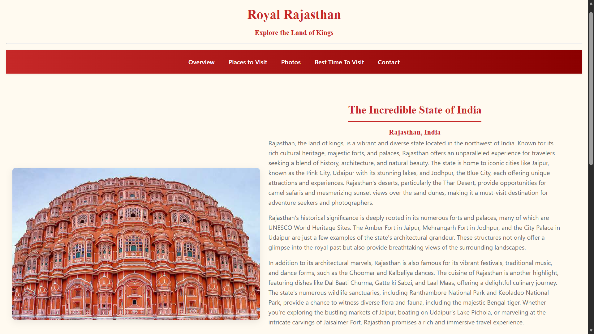

<div align="center">

# 🏰 Royal Rajasthan

### Discover the Timeless Beauty of Rajasthan

*A responsive tourism website showcasing Rajasthan's magnificent forts, palaces, culture, traditions, and famous tourist destinations.*

<br>

<p>


</p>

</div>

---

# 📖 About

**Royal Rajasthan** is a responsive tourism website developed to showcase the rich heritage, culture, architecture, and tourist attractions of Rajasthan.

The website provides visitors with an engaging experience through informative content, attractive visuals, responsive layouts, and interactive user interfaces built using HTML, CSS, and JavaScript.

This project was created to strengthen my frontend development skills while designing a visually appealing tourism website inspired by the royal heritage of Rajasthan.

---

# ✨ Features

- 🏰 Beautiful and responsive homepage
- 📍 Explore famous tourist destinations
- 🖼️ Interactive photo gallery
- 🗓️ Best time to visit Rajasthan
- 📞 Contact page
- 📱 Fully responsive design
- ✨ Smooth scrolling and interactive UI
- 🎨 Modern and clean interface

---

# 📂 Project Structure

```text
royal-rajasthan-site
│
├── css
│   └── style.css
│
├── images
│   ├── homepage.png
│   ├── places.png
│   └── gallery.png
│
├── js
│   └── main.js
│
├── index.html
├── places.html
├── photos.html
├── best_time.html
├── contact.html
│
└── README.md
```

---

# 🌐 Website Pages

| Page | Description |
|------|-------------|
| 🏠 **Home** | Introduction to Rajasthan with featured highlights |
| 📍 **Places** | Explore famous tourist destinations with descriptions and images |
| 🖼️ **Gallery** | Collection of photographs showcasing Rajasthan |
| 🗓️ **Best Time** | Information about the ideal season to visit Rajasthan |
| 📞 **Contact** | Contact form for visitor enquiries |

---

# 🛠️ Technologies Used

| Technology | Purpose |
|------------|----------|
| HTML5 | Website Structure |
| CSS3 | Styling & Responsive Design |
| JavaScript | Interactive Features |
| Google Fonts | Typography |
| Font Awesome | Icons |

---

# 📸 Screenshots

<div align="center">

### 🏠 Homepage



<br><br>

### 📍 Tourist Places


<br><br>

### 🖼️ Photo Gallery


</div>

---

# 🚀 Getting Started

## Clone the Repository

```bash
git clone https://github.com/Tarannum2504/royal-rajasthan-site.git
```

## Open the Project

Open the project folder in your preferred code editor.

## Run the Website

Simply open **index.html** in your preferred web browser.

No additional setup or dependencies are required.

---

# 📱 Responsive Design

The website is optimized for:

- 💻 Desktop
- 💼 Laptop
- 📱 Tablet
- 📲 Mobile

---

# 🎯 Learning Outcomes

This project helped me strengthen my understanding of:

- Semantic HTML5
- Responsive CSS Design
- Flexbox & CSS Grid
- JavaScript DOM Manipulation
- Responsive Navigation
- User Interface Design
- Website Structure & Organization
- Frontend Development Best Practices

---

# 🚀 Future Enhancements

Some features that can be added in the future:

- 🗺️ Interactive Rajasthan Map
- 🔍 Search Tourist Destinations
- 🌦️ Live Weather Information
- ⭐ Tourist Reviews & Ratings
- 📍 Google Maps Integration
- 🌐 Multi-language Support

---

# 🤝 Contributing

Contributions are always welcome.

If you'd like to improve this project:

1. Fork the repository
2. Create a new branch
3. Commit your changes
4. Submit a Pull Request

---

# 📄 License

This project is licensed under the **MIT License**.

---

<div align="center">

**If you enjoyed this project, consider giving it a ⭐ on GitHub!**

</div>